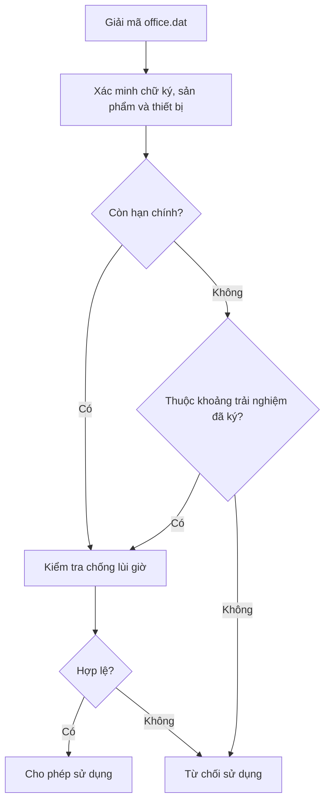

# Trải nghiệm thêm sau hạn

Trong cửa sổ cấp license, phần **Trải nghiệm thêm** xuất hiện khi ngày hết hạn hợp lệ. Nhấn ô giờ/ngày để bật hoặc tắt. Không chọn ô nào thì hết hạn bình thường. Đổi thời điểm hết hạn sẽ xóa lựa chọn cũ.

Ví dụ hết hạn **23/10/2026 16:00**:

| Lựa chọn | Quyền sử dụng thêm |
|---|---|
| Chỉ giờ 16–17 | 23/10 từ 16:00 đến trước 17:00, chỉ trong 24 giờ sau hạn |
| Chỉ ngày 24/10 | Toàn bộ ngày 24/10 |
| Ngày 24/10 và 26/10 + giờ 16–17 | Chỉ 16:00 đến trước 17:00 trong hai ngày đó |
| Không chọn | Không có thời gian thêm |

24 khoảng giờ bắt đầu từ thời điểm hết hạn. Nếu hết hạn 16:30, các ô là 16:30–17:30…15:30–16:30. Khi chọn ngày, khung giờ lặp theo đồng hồ trên đúng ngày được chọn, không mở sang ngày chưa chọn. Khung 23:30–00:30 được giới hạn trong từng ngày đã chọn: 00:00–00:30 và 23:30–24:00.

Các ngày chạy từ ngày sau hạn đến cùng ngày của tháng sau, bao gồm ngày cuối (23/10 → 24/10–23/11). Cuối tháng điều chỉnh theo lịch (31/01/2028 → 01/02–29/02). Ngày chỉ nhập yyyy-MM-dd vẫn hết hạn cuối ngày; muốn khung giờ tròn hãy nhập giờ hết hạn rõ ràng.

## Tích hợp và tương thích

- Cập nhật **LicenseShared.dll** trong các project client và gọi `LicenseRules.Evaluate` sau kiểm tra chữ ký. Mẫu `examples/LicenseGate.cs` đã dùng luồng này.
- Kiểm tra lại trước thao tác cần bảo vệ và định kỳ trong phiên; chỉ kiểm tra lúc khởi động sẽ không tự khóa khi khung giờ kết thúc.
- License có lịch thêm dùng payload **v2**; client cũ không đọc được v2 và sẽ từ chối. License không có lịch vẫn dùng **v1**.
- Các khoảng UTC `[StartUtc, EndUtc)` nằm trong payload được ký, rồi được bọc mã hóa trong cùng **office.dat**. Sửa lịch trong file sẽ làm kiểm tra chữ ký thất bại.
- Múi giờ máy cấp license được dùng lúc lập lịch; đổi múi giờ client không thay đổi các khoảng đã ký. Giờ địa phương mơ hồ/không tồn tại do DST bị từ chối khi tạo lịch.
- Danh sách license hiển thị đang hiệu lực khi trong khung thêm, chờ hiệu lực nếu còn khung sắp tới, hết hạn khi không còn khung nào. Chi tiết license liệt kê các khoảng đã ký.
- Giới hạn này không thay thế chữ ký, ràng buộc thiết bị hoặc chống lùi đồng hồ. Bảo vệ ngoại tuyến vẫn phụ thuộc vào độ tin cậy của đồng hồ và client.
